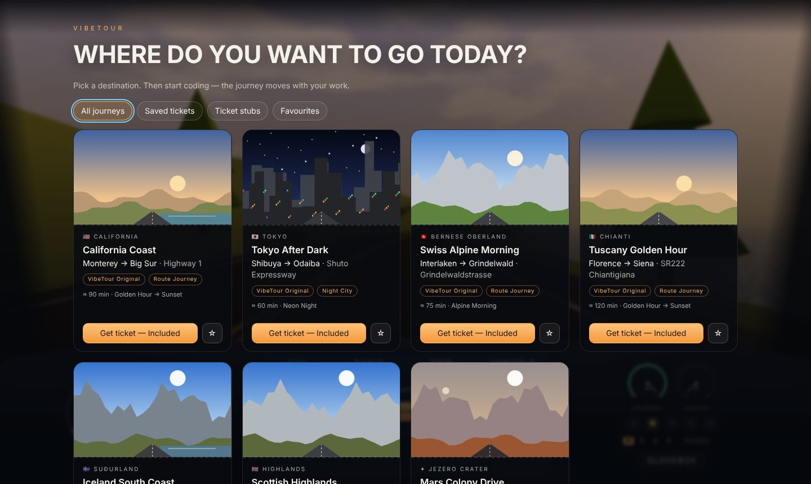
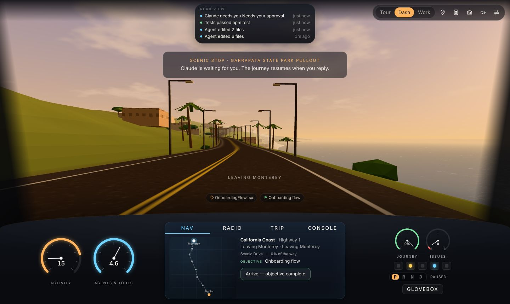
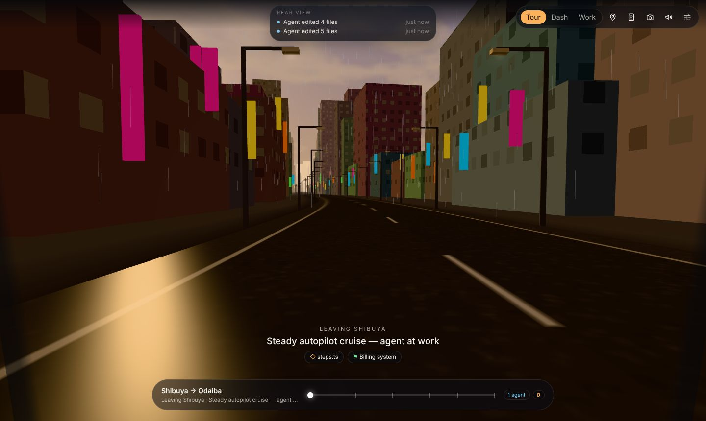
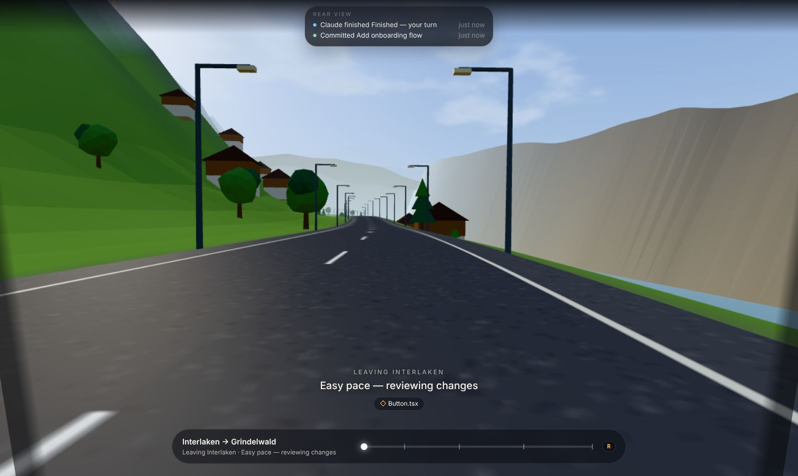
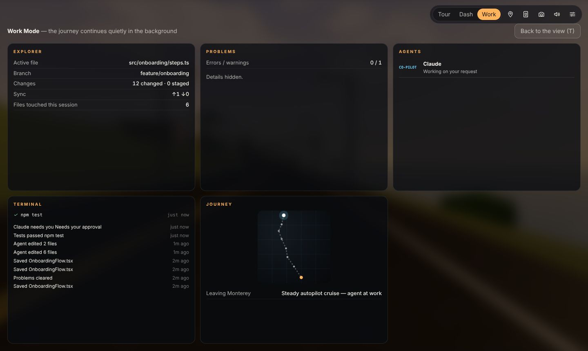

# VibeTour

**See the world while you code.** VibeTour turns a coding session into a journey. While you write code, run tests and supervise coding agents, you travel through a destination of your choice: the California coast at golden hour, Tokyo in the rain, an Alpine valley, Tuscan vineyards. The car's instruments show what is actually happening in your project.



This repository builds the V0/V1 product from the [PRD](vibetour-PRD):

- a **VS Code extension** (also works in VS Code forks such as Cursor and Windsurf)
- a **Companion Display** for a second screen
- a **standalone companion** for any editor or terminal agent

All three share one procedural Three.js renderer and one activity/journey engine.

| Dashboard Mode | Tour Mode (Tokyo Rain) |
| --- | --- |
|  |  |
| **Tour Mode (Swiss Alps)** | **Work Mode** |
|  |  |

## Journeys: how they work and how to make one

- **[Signal Map](docs/signal-map.md):** every signal VibeTour listens to, the moment it becomes, and what the car, the journey and each instrument do about it.
- **[Controls Map](docs/site/controls-map.html):** every control on the dashboard, screen by screen: numbered pictures with a key saying what feeds each one and what a click or a key does. `npm run controls-map` re-makes it after a UI change.
- **[Journey Packs](docs/journey-packs.md):** what a pack contains (route, scene graph, scenic stops, variants, provenance) and how to write one. Today's packs are procedural.
- **[Journey Video Standard](docs/journey-video-standard.md)** (proposed, draft 0.2): how to make a video pack, so creators can build their own journeys and one day sell them. It covers:
  - the three layers: footage plates, a cockpit that steers with the road, and the instruments
  - the world detail that makes footage look real: traffic, people, houses, signs, wear, and sunset, night and rain variants
  - the clips every pack needs, and the optional extra stops
  - Economy, Standard and Cinematic tiers
  - the tools and which model to use for which slot: OpenRouter, HeyGen, image and video models, FFmpeg
  - what each tier costs
  - what a pack must pass to be sold
- **[Footage Study](docs/site/footage-study.html):** the October 2026 bake-off behind draft 0.2: five models, two cockpit designs, what worked and what didn't. The scripts are in [tools/footage/](tools/footage/README.md), and the first car is in [cars/](cars/README.md).
- **[`journey-footage` skill](.claude/skills/journey-footage/SKILL.md):** the step-by-step process for Claude Code, with a [prompt kit](.claude/skills/journey-footage/prompts.md) for realistic tours. Open this repo in Claude Code and ask it to make footage for a journey.

### Advanced video ideas

Not in the standard yet:

1. Let the people, dogs and birds move. Today they stand still or walk slowly, because models garble fast movement.
2. Animals, creatures and funny characters for journeys to weird, faraway or planetary places.
3. A broken-down car with the driver and family sitting at the side of the road. As we pass, they reach out for help, but we never stop. They look sad and dejected, and the kids look hungry. Maybe we add an audio chuckle from the driver. (It's a joke: anybody would stop in the real world.)

## What it does

- **Travel first.** Seven procedurally rendered *Journey Packs*:
  - California Coast (Monterey → Big Sur)
  - Tokyo After Dark (Shibuya → Odaiba)
  - Swiss Alpine Morning (Interlaken → Grindelwald)
  - Tuscany Golden Hour (Florence → Siena)
  - Iceland South Coast (Seljalandsfoss → Vík)
  - Scottish Highlands (Glencoe → Eilean Donan)
  - Mars Colony Drive (a clearly labelled fantasy journey)

  Each pack has its own scenery, landmarks (Bixby Creek Bridge, Tokyo Tower, the Rainbow Bridge, Torre del Mangia, Eilean Donan…), time-of-day and weather variants, and a branching scene graph, so the same trip plays out a little differently each time.
- **Movement represents useful activity, not keystrokes.** An Activity Engine normalises IDE, Git, terminal, task and agent events into the PRD's states (`IDLE`, `THINKING`, `ACTIVE`, `AGENT_ACTIVE`, `VERIFYING`, `WAITING_FOR_USER`, `WARNING`, `BLOCKED`, `COMPLETE`). Calm motion rules follow from those states:

  | What's happening | What the car does |
  | --- | --- |
  | Thinking | Gentle cruising |
  | Tests running | You enter a tunnel or a coastal rock shed |
  | Tests pass | The road opens up |
  | Your agent asks a question, shows a plan or asks for approval | A scenic stop that says which |
  | Your agent's turn ends on an API error | You pull over, and the card says why (*rate limit*) |
  | A failing build left alone | You pull over safely |
  | Long idle | You park somewhere nice |

  The [Signal Map](docs/signal-map.md) has every signal, moment and reaction.

- **Arrival has meaning.** Progress follows productive time and holds at the final approach until you mark the objective complete. Then you arrive, the sun sets, and your **Passport** gets a stamp.
- **Information becomes instruments** (PRD §8):

  | Instrument | Shows |
  | --- | --- |
  | Activity (speedometer) | Your coding; zero while the car is stopped |
  | Agents | How many agents are at work, crew included |
  | Tools | Tool calls and commands in the last minute |
  | Fuel | Journey left |
  | Context | How much of your agent's context window is left |
  | Changes | Files changed and not committed, like the Source Control badge; click it to open Source Control |
  | Battery | Laptop battery, where the browser reports it (off by default) |
  | Temperature | Warnings and errors |
  | Alerts (bell) | What needs you now: a question, a plan, an approval, an agent that stopped, a failing build, your turn, a PR of yours with failing CI, a conflict or requested changes, and changed files. The bells light red, orange or blue; the Alerts tab lists them, and the alert that stopped the car rides on the stop card. One click goes there |
  | Radio | Internet radio and your agents on CB |
  | PRs | The repository's open pull requests, with a lit branch on the ones on your branch (after you connect GitHub) |
  | Console | Running commands, and recent activity and your Git timeline |
  | Glovebox | Project docs |
  | Gear selector | P / R / N / D |

- **Coding remains primary.** `Ctrl+Alt+V` (`⌘⌥V`) toggles between the tour and your full IDE. Every immersive action has a command-palette equivalent, and Work Mode hides the view and drops rendering to a trickle.
- **Opening experience.** "Where do you want to go today?", boarding-pass tickets, *Take me somewhere* (mood + duration), saved tickets, ticket stubs, favourites, and travel memories ("You last visited Big Sur while building Atlas — Return to Big Sur").
- **Capture my workplace.** One keystroke makes a share card ("Coding near Bixby Creek Bridge this evening."). File names never appear in it, and the project name is opt-in.
- **Accessible and light.**
  - Comfort: reduced motion, static scenery (a rotating series of scenic stops, no simulated motion), no camera movement, no weather.
  - Display: high contrast, UI scale, full keyboard control and screen-reader announcements.
  - Performance: 30/60 FPS, low-GPU mode, automatic GPU throttling, and no rendering while hidden.
  - Sound: a procedural soundscape (engine, road, wind, rain, ambience, generative Focus Mix) with independent volumes.
- **A car radio.** The dashboard's Radio tab (`R`) has two bands. **FM** plays internet radio: curated [SomaFM](https://somafm.com/support/) presets, stations near where you're driving, and a search of the [Radio Browser](https://www.radio-browser.info/) directory. It has power, volume, six presets (hold one to save), bass, treble, fader, balance, surround and stereo mix, and equalizer lights that move with the music. **CB** lists your agents.
- **Private by design.** VibeTour reads metadata only (event types, file names, counts, exit codes), never source code. Nothing leaves your machine, except the internet radio you choose to play and, if you connect GitHub for the PRs tab, a request for the repository's open pull requests (numbers, titles, branches, CI, review and merge state; no code). Radio searches and streams go out from VS Code or the CLI, never from the tour page; turn the radio off with `vibetour.radio.enabled` or `--no-radio`. Streaming Mode removes file names, paths, branches, PR titles, commands and messages at the source.

## Try it

You need Node.js 20.19+ or 22.12+ (22 LTS recommended).

```bash
npm install
npm run demo          # browser demo with a simulated coding session → http://127.0.0.1:5177/
```

The demo runs the real engine with a scripted session that follows the PRD's core story: you code, Claude edits files, tests run in a tunnel, the agent asks a question at a scenic stop, and you commit. Open **Demo controls** (top left) to trigger events yourself. Add `?speed=20` to the URL to fast-forward time.

### VS Code extension

```bash
npm run package       # builds dist/ and writes vibetour-<version>.vsix
code --install-extension vibetour-0.1.0.vsix
```

Then run **VibeTour: Open Tour** or press `Ctrl+Alt+V` / `⌘⌥V`.

| Command | |
| --- | --- |
| VibeTour: Open Tour / Toggle Tour ↔ Work (`Ctrl+Alt+V`) | The signature switch between the view and your IDE |
| VibeTour: Where Do You Want to Go Today? / Take Me Somewhere | Quick-pick equivalents of the destination board |
| VibeTour: Arrive — Objective Complete / Set Journey Objective | Earn your arrival |
| VibeTour: Park (End Session) / Resume Journey / End Journey | Multi-session road trips persist per project |
| VibeTour: Refuel and Drive Again | After you arrive: a stop for fuel, then the same route again by a different way (also on the arrival card) |
| VibeTour: Cycle Display Mode | Tour → Dashboard → Work |
| VibeTour: Open Companion Display / Copy Companion Display URL | Second-screen display |
| VibeTour: Open Glovebox | Project docs |
| VibeTour: Show Passport / Capture My Workplace | Passport stamps and share cards |
| VibeTour: Open Radio | The dashboard's radio: FM music, CB agents |
| VibeTour: Toggle Streaming Mode | Hide private details everywhere |
| VibeTour: Copy Claude Code Hook Configuration | Agent integration (see below) |
| VibeTour: Show Pull Requests | Sign in to GitHub and list the repository's open PRs (also the PRs tab's *Connect GitHub*) |

Inside the view: `T` `D` `W` switch modes, `G` destinations, `P` passport, `C` capture, `M` sound, `S` settings, `A` arrive, `?` help.

**Settings:**

| Setting | Controls |
| --- | --- |
| `vibetour.companion.enabled`, `vibetour.companion.port` | Companion Display server |
| `vibetour.privacy.streamingMode` | Streaming Mode |
| `vibetour.radio.enabled` | Internet radio on the FM band (on by default; off makes no network requests). Plays through the Companion Display server, so it needs `vibetour.companion.enabled` too |
| `vibetour.journey.autoResume` | Auto-resume after VS Code restarts |
| `vibetour.tour.openBeside` | Open the tour beside the editor |
| `vibetour.statusBar.enabled` | Status bar item |
| `vibetour.agents.detectExternalEdits` | Treat files changed outside the editor as agent activity |
| `vibetour.yourTurn.pullOver`, `vibetour.yourTurn.pullOverAfterSeconds` | Pull over when an agent finishes its turn and nothing happens for a while (off by default; 30 s) |
| `vibetour.pullRequests.enabled` | The PRs tab and PR alerts, using your GitHub sign-in in VS Code (off until you connect GitHub) |

Each display also has its own settings for these:

- the **Context** gauge: on by default
- the **Battery** gauge: off by default
- the **Changes** gauge: on by default
- **Alerts**: a switch for each kind (questions, plans, approvals, agent stopped, build failing, your turn, pull requests, changed files), all on by default

### Companion Display (second screen)

The extension runs a small server bound to `127.0.0.1`. Every request needs a per-install token, and Host and Origin headers are checked against DNS rebinding. Run **VibeTour: Open Companion Display** and drag the browser window to another monitor, tablet or ultrawide side panel. Each display keeps its own mode and preferences.

### Any editor / terminal agents

```bash
npm run build
node dist/cli.js ~/code/my-project --pack tokyo-night      # or: npm link && vibetour ~/code/my-project
```

The standalone companion:

- watches the folder (it ignores `node_modules`, build output and `.git`)
- polls Git for branch, changes and commits
- accepts agent hook events
- opens the display in your browser

Run `node dist/cli.js --help` for options (`--port`, `--no-open`, `--scope`, `--streaming`, `--your-turn-stop`, `--prs`, `--no-radio`). With `--prs` it lists the `origin` remote's open pull requests, signing in with `GITHUB_TOKEN`, `GH_TOKEN` or the `gh` CLI.

### Claude Code (and other agents)

VibeTour shows your agents in the cockpit. The main agent is your co-pilot on the radio's CB band, and the Agents dial counts it and its sub-agents, the crew. When an agent asks a question, shows a plan to approve or waits for permission, the car pulls into a scenic stop that says which, and the Alerts bell on the rear-view mirror's glass lights up and takes you to it with one click. If a turn ends on an API error, such as a rate limit, the car pulls onto the shoulder and says so. Run **VibeTour: Copy Claude Code Hook Configuration** and paste the result into `.claude/settings.json`. The hooks also feed the Context gauge with how full Claude's context window is, and an optional status line makes it exact. See [docs/agent-integration.md](docs/agent-integration.md) for the hook forwarder, the status line, Codex `notify`, and the provider-neutral HTTP API.

## Development

```bash
npm run typecheck     # tsc, strict
npm test              # vitest unit tests: engine, packs, server, hooks, classifiers, CLI helpers
npm run build         # esbuild: dist/extension.js, dist/cli.js, dist/webview/*
npx playwright test   # end-to-end: browser demo + standalone companion (headless Chromium, software WebGL)
npm run watch         # rebuild on change
```

| Path | What |
| --- | --- |
| `src/core/` | Host-agnostic engine: event model, Activity Engine, motion rules, Journey Engine, Journey Pack schema/validation, passport, session, protocol |
| `src/webview/` | Browser app: Three.js tour renderer (`renderer/`), cockpit and overlays (`ui/`), soundscape, transports, demo host |
| `src/extension/` | VS Code host: IDE and Git adapters, tour panel, status bar, commands |
| `src/server/`, `src/host/` | Companion Display server, session file, shared HTML/CSP, Git parsing, file stores |
| `src/cli/` | Standalone companion |
| `bin/vibetour-hook.js` | Dependency-free agent hook forwarder |
| `packs/<id>/manifest.json` | Built-in Journey Packs |

See [docs/architecture.md](docs/architecture.md) for how the pieces fit together, and [docs/journey-packs.md](docs/journey-packs.md) for authoring packs. [docs/journey-video-standard.md](docs/journey-video-standard.md) is the proposed standard for video packs: what to make, how to generate it, and what it costs.

## Status against the PRD

**Done — V0 (§18):**

- cockpit and route
- day/night
- road movement
- VS Code connection
- coding, agent and activity detection
- active file, Git and diagnostics indicators
- journey progress
- Tour, Work and Companion modes

**Done — V1 (§19):**

- destination picker and seven tours
- weather and day/night variants
- journey lengths and persistent routes
- keyboard shortcuts
- terminal, AI and file panels
- Git and test integration
- journey statistics
- share cards

**Done — other PRD features:**

- Passport, ticket stubs and travel memories
- *Take me somewhere*
- Match my clock
- Streaming Mode
- accessibility and performance controls
- the car radio: internet radio with tone controls and equalizer lights

**Not yet built (V2 and later):**

- aircraft and other travel modes
- real landmark routes from map data
- footage-based packs, the BYOK Journey Generator and Journey Studio
- marketplace and payments (tickets are free and "Included" today)
- gifting, team expeditions and the journey calendar
- live weather
- configurable dashboard widgets

The Journey Pack manifest already follows the PRD §39 layout, so footage-based or generated packs can be added without changing the engine.
