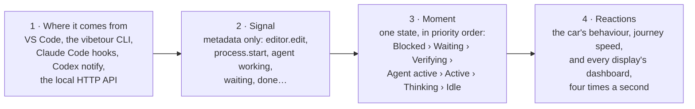

# Signal Map

Every signal VibeTour listens to, the moment it turns into, and what that moment does to the car, the journey and each object on the dashboard. Use it to see what triggers what before you change any of it.

`test/docs.test.ts` keeps this page in step with the code: it fails if a moment or a timing here no longer matches. Captions use the California Coast journey as an example.

To see where each object is, the [Cockpit Map](site/vibetour-cockpit-map.html) has a numbered picture of every screen, with what feeds each control and what a click or a key does.

## The path of a signal

1. **Where it comes from:**
   - VS Code: the editor, terminal, tasks, Problems and Git
   - the `vibetour` CLI's file watcher
   - Claude Code hooks
   - Codex `notify`
   - any agent posting to the local HTTP API
2. **Signal:** a metadata-only event, such as `editor.edit`, `process.start`, or `agent` with a status of *working*, *waiting*, *done*…
3. **Moment:** the Activity Engine boils every recent signal down to one state, checked in priority order:
   - Blocked
   - Waiting
   - Verifying
   - Agent active
   - Active
   - Thinking
   - Idle
4. **Reactions:** the moment picks the car's behaviour and how fast the journey advances. Each display then draws its own dashboard from the same snapshot, four times a second.

## Who decides what

This split decides where any new setting can live.

**The host decides once**, one per VS Code window or CLI. Every screen shows the same car, so a setting that changes when the car stops is one setting per host. The host decides:

- the moment (activity state)
- the car: cruise, slow, stop, pull over
- journey progress, arrival and passport stamps
- captions and the VS Code status bar
- whether your turn pulls the car over

**Each display draws its own**: a VS Code tab, a companion browser. Each display decides:

- gauges, gear and stop pill
- the bell colour each thing in its Alerts tab lights, or none: questions, plans, approvals, an agent that stopped, a build left failing, your turn, PRs that need you, changed files, open PRs, branches ahead of main
- render settings: reduced motion, weather, frame rate, contrast
- sound, and which gauges show (Context, Battery)
- which moments light which cue, such as the blue your-turn light

## Moments and what they do

Top to bottom is the engine's priority order for the car: the first row that matches drives it. Every snapshot also lists all the moments that hold at once, by id, and each display's cues read that list. A stopped car makes no journey progress.

### Car and journey

| Moment | Trigger | Car | Journey |
| --- | --- | --- | --- |
| **Arrived** `arrived` COMPLETE | The final approach reached 100%. | Stopped. Arrival scene. | **Passport stamped**, trip added to the library. *Refuel and drive again* (arrival card or command) starts the same route as a new journey, by a different way where the scene graph has one, after a 15 s stop at the pack's gas station. |
| **Final approach** `final-approach` journey phase | You click *Arrive — objective complete*, press <kbd>A</kbd>, or run the command. | 60%. Only parking stops it, even when you're idle or an agent is waiting. | 90 s of driving to 100%. |
| **Agent hit a problem** `agent-problem` BLOCKED | An agent reports `error`: Claude Code's `StopFailure` (a turn ended on an API error such as a rate limit), or the HTTP API. Lasts up to 10 min. | Stopped. Pulls onto the shoulder. | Paused. |
| **Build left failing** `build-failing` BLOCKED | The last build failed, then 30 s passed with no input, no agent working and nothing verifying. | Stopped. Pulls onto the shoulder. | Paused. |
| **Agent needs you** `agent-waiting` WAITING_FOR_USER | An agent is `waiting`: Claude Code asks a question (`AskUserQuestion`), shows a plan to approve (`ExitPlanMode`), shows a permission prompt, or an MCP server asks for input. Only while you haven't edited code in the last 20 s. Expires after 30 min. | Stopped. Scenic stop after 2 s. | Paused. |
| **Verifying** `verifying` VERIFYING | A test, build or lint command is running, for its first 10 min. Watch modes, dev servers and background tasks don't count. | 85%. Checkpoint after 4 s: a tunnel, rock gallery or long straight is staged ahead. | Full speed (1×). |
| **Agent at work** `agent-working` AGENT_ACTIVE | An agent is working or using a tool (heard from in the last 10 min), or files changed outside the editor in the last 15 s. | 100%. Cruise. | Full speed (1×). |
| **You're coding** `coding` ACTIVE | You typed, saved, switched files, moved the cursor or focused the window in the last 20 s. | 100%. Cruise. Easy pace (80%) while you review diffs. | Full speed (1×). |
| **Thinking** `thinking` THINKING | Quiet, but your last input was under 5 min ago (2 min if VS Code is in the background; 5 min while an agent CLI runs in a terminal). | 65%. Gentle cruise. | Three-quarter speed (0.75×). |
| **Idle** `idle` IDLE | Quiet for longer than that. | 35%. Slow for 3 min, then a scenic stop. | Paused. |
| **Heads-up** `heads-up` WARNING | Errors in Problems, or the last test, lint or build failed, while you're coding or thinking. Shown on top of that moment. `problems` (any errors or warnings) and `checks-failing` (a failed run here, or failing CI or a failed deployment on GitHub for the pull request on your branch, such as a Vercel preview) also hold on their own, at any time. | No change: the car follows the moment underneath. | No change. |
| **Your turn** `your-turn` your move | Claude Code `Stop` or Codex turn complete, with no agent working or waiting. Ends when the agent works again or 15 min after it finished. `idle_prompt` and `auth_success` are ignored. | **Keep driving** (default): the car follows your activity. **Pull over** (opt-in): a scenic stop after 30 s of quiet (5–3600 s). Typing restarts the count; replying drives on. | Paused while pulled over. |
| **Parked** `parked` journey phase | The Park command, or closing VS Code or the CLI. | Stopped. | Saved. If closing parked it, it resumes as soon as you work again (the auto-resume setting). |
| **No journey** `no-journey` | Nothing booked yet. | 55%. A preview drive of a destination. | — |

### Dashboard

| Moment | Caption and stop pill | Gear and bells | Rest of the dashboard and sound |
| --- | --- | --- | --- |
| **Arrived** | *"Arrived in Big Sur"*. Arrival card with the stamp, *Refuel and drive again* and *Choose next destination*. Refuelling: *"Refuelling at a Carmel Highlands gas station — then Monterey to Big Sur again"*, with a stop card. | Gear **P**. | Fuel reads 100%. Status bar: *Arrived*. Soft music. |
| **Final approach** | *"Final approach to Big Sur"*. Arrival scenery. | Gear **D**. | Sound follows speed. |
| **Agent hit a problem** | *"Pulled over safely — Claude needs help"*. Stop pill, red: *Claude stopped · rate limit*, then *Pulled over until you get it going again.* | Gear **P**. Bells red. | Alerts tab: the same pill. Recent: *Claude hit a problem*. Radio: *Needs help*. Soft music. |
| **Build left failing** | *"Pulled over safely — Build is failing"*. Stop pill, red: *Build failing*, then *Pulled over until the build passes.* It opens Problems. | Gear **P**. Bells red. | Issues up. Recent: *Build failed*. |
| **Agent needs you** | The car stops at once. Where the pack places a scenic stop within 2.5% of the trip, it is at that stop and takes its name; between stops it's *a turnout*. Says why: *"Scenic stop at Bixby Creek Overlook — Claude has a question for you"* (or *"Scenic stop at a turnout — …"*), *"… has a plan for you to approve"* or *"… needs your approval"*. The stop pill, red, says it and what resumes the drive: *Claude has a question* / *Answer to resume your journey.*, *Claude has a plan to approve* or *Claude needs approval · Bash* / *Reply to resume your journey.* Agents that don't say why: *"… is waiting for you"*. | Gear **P**. Bells red. | Alerts tab: the same pill. Recent: the same. Radio: *Waiting for you*. Soft music. |
| **Verifying** | *"Through the tunnel — verification running"*. | Gear **D**. | Console: *npm test* with a spinner. Recent: *Tests running*, then *passed* or *failed*. |
| **Agent at work** | *"Steady autopilot cruise — agent at work"*. | Gear **D**. | Agents and Tools dials up; Agents counts crew agents too. Radio shows status. Recent: *Agent edited 3 files*. Bright music. |
| **You're coding** | *"Cruising"*, *"Departing Monterey"*, or *"Easy pace — reviewing changes"*. | Gear **D**, or **R** within 60 s of opening a diff. | Activity up. Alerts tab: the file you're in. Bright music. |
| **Thinking** | *"Gentle cruising — thinking time"*. | Gear **N** (**R** after a diff). | Medium music. |
| **Idle** | *"Slowing down — taking a breather"*, then *"Parked at Bixby Creek Overlook — resume whenever you're ready"* with a stop card. | Gear **N**, then **P**. | Soft music once stopped. |
| **Heads-up** | No change. | — | Issues: errors and warnings, a failed test, build or lint, and failing CI or a failed deployment on your branch's pull request. |
| **Your turn** | When pulled over: *"Scenic stop at Bixby Creek Overlook — Claude finished, your turn"*. Stop pill, orange: *Claude finished · your turn*, then *Reply or get back to work to drive on.* | Gear **P** when pulled over. Bells orange. | Alerts tab: the same pill. Recent: *Claude finished*. Radio: *Finished*. |
| **Parked** | *"Parked — your journey is saved"*. Stop card with *Resume journey*. | Gear **P**. | Status bar: *Parked*. |
| **No journey** | *"Where do you want to go today?"* The destination board opens. | — | — |

## Every dashboard object and what drives it

The same wiring, read the other way: pick an object and see which signals reach it. There are no warning lights: the stop pill, the bells and the dials say what they used to.

| Object | Driven by | Lit or moved during |
| --- | --- | --- |
| **Gauges and gear** | | |
| Activity (speedometer) | Your activity score: edits (bigger edits count more), saves, navigation, focus, plus outside edits. Each one kicks the needle up; with nothing new it halves every 15 s, so it settles near zero about a minute after you stop. Like a speedometer, it reads 0 while the car is stopped. Its top quarter is a red zone, marked faintly on the scale; past 75% the arc runs red. | You're coding, Agent at work |
| Agents | How many agents are at work right now: the main agent and its crew (each Claude Code `Task`/`Agent` call until it reports back). 0 to 8; six or more at once reach the red zone, where your plan's usage goes fastest. | Agent at work |
| Tools | Tool calls (each `PreToolUse`) and commands started in the last minute. Full at 30. No red zone: a busy agent is no fault. | Agent at work, Verifying |
| Stop pins | When the car stops, Activity, Agents and Tools each leave a white pin where the needle stood, so you can see what they read before the stop. The pins go when the drive resumes. | Every stop |
| Journey | Journey progress: the percent done, the needle rising from empty on the left as you set off to full on the right on arrival. Empty again when you refuel; ∞ on a free drive. | Every moving moment |
| Context | How much of the fullest agent's context window is left: from Claude Code's transcript or status line, or the HTTP API's `context`. Reads — until an agent reports it. Its bottom quarter is a red zone: under 25% left, the whole arc turns red. On by default; Settings › Display on each screen. | Any agent signal that reports context |
| Prompt cache | Two dots under Context, level with the gear: the hit share of that agent's session (input read from the cache) and the minutes until its cache goes cold. Blue; orange under your thresholds (50% and 15 min by default, Settings › Display); the timer red at 0. | Claude Code's hooks |
| Changes | Files changed and not yet committed, staged ones included, like the editor's Source Control badge: dark at 0, then a lit blue ring and a white number. Twenty files sit at 75%, where its red zone starts; 21 and up run red. ↑N under the number: commits to push. Click it to open Source Control (VS Code, Cursor, Windsurf). On by default; Settings › Display on each screen. | Any edit, save or commit |
| Battery | This computer's battery, as five lights beside Journey, one per fifth of a charge: green, amber at 25% and under, red at 10%; the top light pulses while charging. On by default; Settings › Display on each screen. Hidden where the browser doesn't report battery (Safari, Firefox) and until a battery shows up: a desktop, or a laptop that's plugged in and full, reports no battery. | — |
| Temperature | Errors, warnings (a fifth as much) and failed checks: a test, build or lint here, or on GitHub the CI or latest deployment of your branch's pull request (Vercel, Netlify or anything that reports a deployment). Scaled so more than three issues (a score of 4) reach its red zone at 75%, which burns a deeper red. | Heads-up, Build left failing |
| Gear P · R · N · D | P when stopped. R within 60 s of a diff while coding or thinking. D while coding, agent at work, verifying or on final approach. N otherwise. | Every moment |
| **Windshield and mirrors** | | |
| Stop pill | Why the car stopped, as one pill in the middle of the window: what happened, then what resumes the drive, quieter (*Claude has a question* / *Answer to resume your journey.*). A question, a plan, an approval, an API error, a failing build, your turn, a breather, refuelling, or parked (with *Resume journey* under it). When an alert stopped the car, the pill is that alert, coloured like the bells; clicking it goes where you act. At most 440 px wide: a long message wraps and the pill grows taller. | Agent needs you, Your turn, Idle, Blocked, Parked |
| Windshield | Nothing, in any mode: places are named on the Nav screen (and, in the footage, on signs outside). In Tour mode the dashboard comes up while the car is stopped, and goes when it drives on. | — |
| Alerts bell (on the rear-view mirror's glass, near its right end) | Lit by the loudest colour lit. By default **red** when something stopped the car (a question, a plan, an approval, an agent that stopped, a build left failing), **orange** when something needs you but the car may drive on (your turn, a PR of yours that needs you), **blue** for files changed and not committed. Open PRs and branches ahead of main light nothing until you pick a colour for them. Each thing's colour, or Off, is set in Settings › Alerts on each screen. Dark when there is nothing. Clicking it opens the dash on the Alerts tab. | Any alert, changes, open PRs, branches |
| Rear-view mirror | A plain mirror: nothing written on it. Its only display is the Alerts bell, a glowing glyph on its glass. The recent events it used to list are the Console tab's *Recent* log. On a phone, and in Tour mode on a narrow screen, the mirror hides and the bell stands alone on a dark disc. | — |
| **Center screen** | | |
| Nav tab | The route map: the towns, the journey's scenic stops as green diamonds where the pack places them (lit while the car is stopped at one), the road done and the car. Beside it: where you are (*Stopped at Bixby Creek Overlook* at a stop), the trip and progress, the objective and *Arrive*. | Every moving moment, stops |
| Radio tab | Two bands. **CB**: every agent with its status: Working, Using tools, Waiting for you, Standing by, Finished, Needs help; an amber dot on the CB button while one is waiting or needs help. **FM**: internet radio (SomaFM presets, stations near the journey, Radio Browser search) with the song title from the stream, presets 1–6, tone controls and equalizer lights. FM follows no moment. | Any agent signal (CB) |
| Alerts tab (bell) | Left, *Needs you*: a pill per alert, most urgent first, in the colour its kind lights the bells, only while it holds; clicking one goes where you act (the agent's terminal, else the editor; the PR on GitHub; Problems). Under it, *Open PRs*: a green pill per open pull request, in the PRs tab's order, once GitHub is connected; clicking one opens it on GitHub. Then *Branches vs main*: a violet pill per local branch with commits main lacks, plus the one checked out, each with *↓behind \| ↑ahead*; clicking a pushed one opens GitHub's comparison with main. Right: the file you're in, and the changed files; click one to open it in VS Code. Titles and names are hidden in Streaming Mode. Each side scrolls on its own and fades at the bottom while more is below. The tab's bell lights like the top bell. Settings › Alerts gives each thing a bell colour (Off, Blue, Orange, Red) on each screen: Off hides an alert, and only keeps the bells dark for files, PRs and branches. | Agent needs you, Agent hit a problem, Build left failing, Your turn, Pull requests, changes, branches |
| PRs tab | The repository's open pull requests, once you connect GitHub: a large number, title, CI dot, how far the branch is ahead of and behind its base, when it was opened (*Oct 14, 3:12 PM*) and by whom, draft, conflict and review. A lit branch marks the ones on your current branch, listed first. The tab's count turns amber when one needs you. Click a row to open it on GitHub. | Pull requests |
| Console tab | Running commands with elapsed time, the last test, build and lint results, and *Recent*: the last eight events (saves, test/build/check results, commits, branch switches, an agent's question / plan / approval / finish / problem, agent edits, PR opened). | Verifying, most moments |
| Arrival card | The journey arrived. | Arrived |
| **Outside the dashboard** | | |
| Sound | Engine, road and wind follow the car's speed. The Focus Mix is brightest while coding or an agent works, then verifying, thinking, and softest when stopped. The radio plays on its own volume, even with tour audio off, and stops when the panel closes (Work mode in VS Code); the Companion Display keeps playing. The radio's equalizer lights follow whatever music plays: the radio, or the Focus Mix. | Every moment (Focus Mix) |
| VS Code status bar | Destination, percent and a short caption; or *Parked* / *Arrived*. | Every moment |
| Screen reader | Announces each new caption. | Every change of caption |

## Signals coming in

What each source sends, and the moment it feeds.

| Source signal | Becomes | Feeds |
| --- | --- | --- |
| **Claude Code hooks** | | |
| `SessionStart` | Claude: standing by | — |
| `UserPromptSubmit` | Claude: working. Crew left over from the last turn leave. | Agent at work |
| `PreToolUse` | Claude: using Edit, Bash…. The Tools dial counts it. | Agent at work |
| `PreToolUse` on `Task`/`Agent` | A crew agent joins (NAV, ENG, QA, COMMS, OPS by type): the Agents dial counts it, and CB lists it | Agent at work |
| `PostToolUse` | Claude: working. On `Task`/`Agent`, that crew agent leaves. | Agent at work |
| `PreToolUse` on `AskUserQuestion` | Claude: waiting, "Has a question for you" | Agent needs you |
| `PreToolUse` on `ExitPlanMode` | Claude: waiting, "Has a plan for you to approve" | Agent needs you |
| `Notification` (`permission_prompt`) | Claude: waiting, "Needs your approval to use Bash" (the tool from the last `PreToolUse`); still a question or a plan if one is open | Agent needs you |
| `Notification` (`elicitation_dialog`, `elicitation_url_dialog`, `agent_needs_input`) | Claude: waiting, "Needs your input" | Agent needs you |
| `Notification` (`idle_prompt`, `auth_success` and other notices that ask nothing) | Ignored | — |
| `Stop` | Claude: finished, "your turn". Leftover crew leave. Starts the your-turn count. | Your turn |
| `StopFailure` | The turn ended on an API error: Claude needs help, "Stopped: rate limit" (only the error's kind is forwarded). Leftover crew leave. | Agent hit a problem |
| Interrupting Claude (Esc) | No hook fires: Claude reads as working until your next prompt, or 10 min. | — |
| `PreCompact` | Claude: compacting context | Agent at work |
| `SubagentStart`, `SubagentStop` | Ignored: `PostToolUse` retires the exact crew agent | — |
| `SessionEnd` | Claude and its crew leave the cockpit | — |
| Context on `SessionStart`, `PostToolUse`, `Stop` | The forwarder reads the last reply's token counts from the transcript and sends how full the window is, for the Context gauge | — |
| Cache on `SessionStart`, `PostToolUse`, `Stop`, `UserPromptSubmit` | With the context reading, the same reply's cache counts, id, time and cache lifetime (5 min or 1 h); a prompt sends just its time. For the cache dots under the Context gauge: the session's hit share and the countdown to a cold cache. | — |
| Status line (`--statusline`, optional) | Claude Code's own exact context reading after each reply, for the Context gauge. Not activity: it changes nothing else. | — |
| **Other agents** | | |
| Codex `agent-turn-complete` | Codex: finished, "your move" | Your turn |
| HTTP API `working` / `tool` | That agent is working | Agent at work |
| HTTP API `waiting` | That agent waits for you; `ask` (`question`, `plan`, `approval`) and `tool` say why | Agent needs you |
| HTTP API `error` | That agent needs help | Agent hit a problem |
| HTTP API `idle` / `done` | Status only | Your turn |
| HTTP API `context` | Context-window use, for the Context gauge | — |
| **VS Code** | | |
| Typing in the active editor | `editor.edit`, by you | You're coding |
| Edits in an editor you can't see | `editor.edit`, by an agent | Agent at work |
| A file rewritten on disk | `fs.external`, also for the file in the active editor | Agent at work |
| Save, switch file, move the cursor, scroll | `editor.save`, `editor.focus`, `editor.navigate` | You're coding |
| Open a diff | `editor.review` | Gear R, easy pace |
| VS Code gains or loses focus | `window.focus` | Thinking (5 or 2 min) |
| Problems panel changes | `diagnostics` | Heads-up |
| A terminal command (shell integration) | `process`, classed as test, build, lint, install, run, agent or git | Verifying |
| A task runs | `process`; background tasks count as running apps | Verifying |
| Debugging | `process` (run) | — |
| Git status, commits, branch switches | `git` (counts and changed file names), `git.commit`, `git.branch` | Recent, Changes gauge, Alerts tab |
| Branches beside main: at once after a switch or a commit, else at most every 30 s | `git.branches`: each local branch with commits main (`origin/main`, else `main`) lacks, the one checked out, how far each is ahead and behind, and whether it's pushed to GitHub. From `git for-each-ref` and `git rev-list --count`. | Alerts tab |
| **GitHub** (after you connect it) | | |
| Open pull requests, every 2 min, sooner after a push or a branch switch | `github.prs`: numbers, titles, branches, authors, CI, review and merge state, ahead/behind. No code. | PRs tab, Alerts tab, Recent |
| **vibetour CLI** | | |
| A file changes | A save by you, or an outside edit while an agent reports working | You're coding / Agent at work |
| Git polling | `git`, `git.commit`, `git.branch`, `git.branches` | Recent, Changes gauge, Alerts tab |
| `--prs`: GitHub, with `GITHUB_TOKEN` or the `gh` CLI's sign-in | `github.prs` | PRs tab, Alerts tab |

## The clock behind it

| Time | What it means | Where it's set |
| --- | --- | --- |
| 20 s | Input still counts as coding | `activeWindowMs` |
| 5 min | Quiet but focused still counts as thinking | `thinkingWindowMs` |
| 2 min | Thinking while VS Code is in the background | `unfocusedThinkingMs` |
| 15 s | An outside file edit means an agent is at work | `externalEditWindowMs` |
| 10 min | An agent's last "working" is trusted this long | `agentStaleMs` |
| 30 min | An agent's "waiting" expires | `waitingExpiryMs` |
| 30 s | A failed build left alone becomes Blocked | `blockedAfterMs` |
| 60 s | A diff keeps the gear in R | `reviewWindowMs` |
| 10 min | Longest a run counts as Verifying | `verificationMaxMs` |
| 3 min | Idle before the scenic stop | `scenicStopAfterMs` |
| 30 s | Quiet after an agent's turn before a your-turn stop, when that's on | `vibetour.yourTurn.pullOverAfterSeconds` |
| 15 min | A finished agent leaves; your turn ends | `AGENT_EXPIRY_MS` |
| 4 · 2 · 1.5 s | Hold before a checkpoint, a stop, anything else | `holdMs`, `defaultHoldMs` |
| 15 s | Refuelling before driving a route again; typing doesn't cut it short | `refuelMs` |
| 250 ms | A new snapshot reaches every display | — |

The first ten, and `refuelMs`, live in `DEFAULT_ACTIVITY_CONFIG` (`src/core/activity.ts`) and `DEFAULT_MOTION_CONFIG` (`src/core/motion.ts`).

## Your turn: the two settings

One setting for the car, shared by every screen, and one cue per display.

**Car (host setting): when an agent finishes its turn**, *Keep driving* (default) or *Pull over after 30 s*.

- VS Code: `vibetour.yourTurn.pullOver` and `vibetour.yourTurn.pullOverAfterSeconds`
- CLI: `--your-turn-stop 30`
- Demo: `?turnStop=30`

The count starts at `Stop`, so it works for every agent and doesn't wait for `idle_prompt`.

Every display lights its bells orange for your turn.

---

Drawn from:

- `src/core/activity.ts`, `motion.ts`, `moments.ts`, `hooks.ts` and `session.ts`
- `src/webview/ui/cockpit.ts`
- the VS Code adapters
