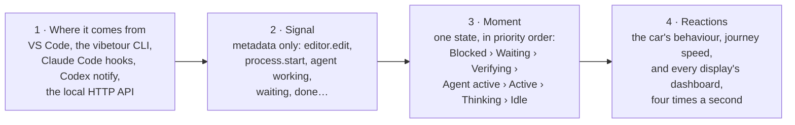

# Signal Map

Every signal VibeTour listens to, the moment it turns into, and what that moment does to the car, the journey and each object on the dashboard. Use it to see what triggers what before you change any of it.

`test/docs.test.ts` keeps this page in step with the code: it fails if a moment or a timing here no longer matches. Captions use the California Coast journey as an example.

## The path of a signal

1. **Where it comes from:**
   - VS Code: the editor, terminal, tasks, Problems and Git
   - the `vibetour` CLI's file watcher
   - Claude Code hooks
   - Codex `notify`
   - any agent posting to the local HTTP API
2. **Signal:** a metadata-only event, such as `editor.edit`, `process.start`, or `agent` with a status of *working*, *waiting*, *done*…
3. **Moment:** the Activity Engine boils every recent signal down to one state, checked in priority order:
   - Blocked
   - Waiting
   - Verifying
   - Agent active
   - Active
   - Thinking
   - Idle
4. **Reactions:** the moment picks the car's behaviour and how fast the journey advances. Each display then draws its own dashboard from the same snapshot, four times a second.

## Who decides what

This split decides where any new setting can live.

**The host decides once**, one per VS Code window or CLI. Every screen shows the same car, so a setting that changes when the car stops is one setting per host. The host decides:

- the moment (activity state)
- the car: cruise, slow, stop, pull over
- journey progress, arrival and passport stamps
- captions and the VS Code status bar
- whether your turn pulls the car over

**Each display draws its own**: a VS Code tab, a companion browser. A dashboard cue can differ per screen, like today's display settings. Each display decides:

- lights, gauges, gear, stop card, mirrors and HUD
- render settings: reduced motion, weather, frame rate, contrast
- sound, and which gauges show (Context, Battery)
- which moments light which cue, such as the blue your-turn light

## Moments and what they do

Top to bottom is the engine's priority order for the car: the first row that matches drives it. Every snapshot also lists all the moments that hold at once, by id, and each display's cues read that list. A stopped car makes no journey progress.

### Car and journey

| Moment | Trigger | Car | Journey |
| --- | --- | --- | --- |
| **Arrived** `arrived` COMPLETE | The final approach reached 100%. | Stopped. Arrival scene. | **Passport stamped**, trip added to the library. |
| **Final approach** `final-approach` journey phase | You click *Arrive — objective complete*, press <kbd>A</kbd>, or run the command. | 60%. Only parking stops it, even when you're idle or an agent is waiting. | 90 s of driving to 100%. |
| **Agent hit a problem** `agent-problem` BLOCKED | An agent reports `error` (HTTP API only; Claude Code hooks never send it). Lasts up to 10 min. | Stopped. Pulls onto the shoulder. | Paused. |
| **Build left failing** `build-failing` BLOCKED | The last build failed, then 30 s passed with no input, no agent working and nothing verifying. | Stopped. Pulls onto the shoulder. | Paused. |
| **Agent needs you** `agent-waiting` WAITING_FOR_USER | An agent is `waiting` (a Claude Code permission prompt) and you haven't edited code in the last 20 s. Expires after 30 min. | Stopped. Scenic stop after 2 s. | Paused. |
| **Verifying** `verifying` VERIFYING | A test, build or lint command is running, for its first 10 min. Watch modes, dev servers and background tasks don't count. | 85%. Checkpoint after 4 s: a tunnel, rock gallery or long straight is staged ahead. | Full speed (1×). |
| **Agent at work** `agent-working` AGENT_ACTIVE | An agent is working or using a tool (heard from in the last 10 min), or files changed outside the editor in the last 15 s. | 100%. Cruise. | Full speed (1×). |
| **You're coding** `coding` ACTIVE | You typed, saved, switched files, moved the cursor or focused the window in the last 20 s. | 100%. Cruise. Easy pace (80%) while you review diffs. | Full speed (1×). |
| **Thinking** `thinking` THINKING | Quiet, but your last input was under 5 min ago (2 min if VS Code is in the background; 5 min while an agent CLI runs in a terminal). | 65%. Gentle cruise. | Three-quarter speed (0.75×). |
| **Idle** `idle` IDLE | Quiet for longer than that. | 35%. Slow for 3 min, then a scenic stop. | Paused. |
| **Heads-up** `heads-up` WARNING | Errors in Problems, or the last test, lint or build failed, while you're coding or thinking. Shown on top of that moment. `problems` (any errors or warnings) and `checks-failing` (a failed run) also hold on their own, at any time. | No change: the car follows the moment underneath. | No change. |
| **Your turn** `your-turn` your move | Claude Code `Stop` or Codex turn complete, with no agent working or waiting. Ends when the agent works again or 15 min after it finished. `idle_prompt` and `auth_success` are ignored. | **Keep driving** (default): the car follows your activity. **Pull over** (opt-in): a scenic stop after 30 s of quiet (5–3600 s). Typing restarts the count; replying drives on. | Paused while pulled over. |
| **Parked** `parked` journey phase | The Park command, or closing VS Code or the CLI. | Stopped. | Saved. If closing parked it, it resumes as soon as you work again (the auto-resume setting). |
| **No journey** `no-journey` | Nothing booked yet. | 55%. A preview drive of a destination. | — |

### Dashboard

| Moment | Caption and stop card | Lights and gear | Rest of the dashboard and sound |
| --- | --- | --- | --- |
| **Arrived** | *"Arrived in Big Sur"*. Arrival card with the stamp. | Gear **P**. | Fuel reads 100%. Status bar: *Arrived*. Soft music. |
| **Final approach** | *"Final approach to Big Sur"*. Arrival scenery. | Gear **D**. | Sound follows speed. |
| **Agent hit a problem** | *"Pulled over safely — Aider needs help"*. Stop card: *Pulled over safely*. | **Hazard** on. Gear **P**. | Rear view: *Aider hit a problem*. Radio: *Needs help*. Soft music. |
| **Build left failing** | *"Pulled over safely — Build is failing"*. Stop card. | **Hazard** and **check engine** on. Gear **P**. | Temperature up. Rear view: *Build failed*. Strip: ⚠. |
| **Agent needs you** | *"Scenic stop at Bixby Creek Overlook — Claude is waiting for you"*. Stop card says it resumes when you reply. | **Agent waiting** light on. Gear **P**. | Rear view: *Claude needs you*. Radio: *Waiting for you*. Soft music. |
| **Verifying** | *"Through the tunnel — verification running"*. | Gear **D**. Check engine updates when it ends. | HUD chip *npm test · running*. Strip: *Verifying*. Console spinner. Rear view: *Tests running*, then *passed* or *failed*. |
| **Agent at work** | *"Steady autopilot cruise — agent at work"*. | Gear **D**. | Tachometer up. Side mirrors show crew agents. Radio shows status. Strip: *1 agent*. Rear view: *Agent edited 3 files*. Bright music. |
| **You're coding** | *"Cruising"*, *"Departing Monterey"*, or *"Easy pace — reviewing changes"*. | Gear **D**, or **R** within 60 s of opening a diff. | Speedometer up. HUD chip with the active file. Bright music. |
| **Thinking** | *"Gentle cruising — thinking time"*. | Gear **N** (**R** after a diff). | Medium music. |
| **Idle** | *"Slowing down — taking a breather"*, then *"Parked at Bixby Creek Overlook — resume whenever you're ready"* with a stop card. | Gear **N**, then **P**. | Soft music once stopped. |
| **Heads-up** | No change. | **Warnings** light (any errors or warnings). **Check engine** (a failed test, build or lint). | Temperature gauge. Strip: ⚠ and *2 errors*. |
| **Your turn** | When pulled over: *"Scenic stop at Bixby Creek Overlook — Claude finished, your turn"*. Stop card: *Claude finished its turn*. | **Blue your-turn light**, if this display's Your-turn cue is on (off by default). Gear **P** when pulled over. | Rear view: *Claude finished*. Radio: *Finished*. |
| **Parked** | *"Parked — your journey is saved"*. Stop card with *Resume journey*. | Gear **P**. | Status bar: *Parked*. |
| **No journey** | *"Where do you want to go today?"* The destination board opens. | — | — |

## Every dashboard object and what drives it

The same wiring, read the other way: pick an object and see which signals reach it. The warning lights read from one moment-to-cue table per display (`src/webview/ui/cues.ts`). That table is what a dashboard designer would edit.

| Object | Driven by | Lit or moved during |
| --- | --- | --- |
| **Warning lights** | | |
| Check engine | Cue table: `checks-failing`. The last test, build or lint result failed. | Heads-up, Build left failing |
| Warnings | Cue table: `problems`. Any errors or warnings in Problems. | Heads-up |
| Hazard | Cue table: `agent-problem`, `build-failing`. The car pulled over. | Agent hit a problem, Build left failing |
| Agent waiting | Cue table: `agent-waiting`. | Agent needs you |
| Your turn (blue) | Cue table: `your-turn`, only when this display's Your-turn cue is *Blue light*. Hidden otherwise. | Your turn |
| Headlights | Scenery only: dusk, night, rain or fog on this journey. | — |
| **Gauges and gear** | | |
| Speedometer | Your activity score: edits (bigger edits count more), saves, navigation, focus, plus outside edits. Fades with a 15 s half-life. | You're coding, Agent at work |
| Tachometer | Agent and tool score: agent events, outside edits, commands starting, commands running, agents working. 20 s half-life. | Agent at work, Verifying |
| Fuel | Journey progress: reads the percent while the needle drops toward E. | Every moving moment |
| Context | How much of the fullest agent's context window is left: from Claude Code's transcript or status line, or the HTTP API's `context`. Reads — until an agent reports it. On by default; Settings › Display on each screen. | Any agent signal that reports context |
| Battery | This computer's battery. Off by default; Settings › Display on each screen. Hidden where the browser doesn't report battery (Safari, Firefox) and until a battery shows up: a desktop, or a laptop that's plugged in and full, reports no battery. | — |
| Temperature | Errors, warnings (a fifth as much) and failed checks. | Heads-up, Build left failing |
| Gear P · R · N · D | P when stopped. R within 60 s of a diff while coding or thinking. D while coding, agent at work, verifying or on final approach. N otherwise. | Every moment |
| **Windshield and mirrors** | | |
| Stop card | The car stopped (scenic stop, pull over) or the journey is parked. | Agent needs you, Your turn, Idle, Blocked, Parked |
| HUD | Location and caption, plus chips for the active file, the objective and a running test, build or lint. | Every moment |
| Rear-view mirror | The last four events: saves, test/build/check results, commits, branch switches, agent needs you / finished / hit a problem, agent edits. | Most moments |
| Side mirrors | Crew agents (each Claude Code `Task`/`Agent` call until it reports back), and any agent after the first. | Agent at work |
| **Center screen and strip** | | |
| Radio tab | Every agent with its status: Working, Using tools, Waiting for you, Standing by, Finished, Needs help. | Any agent signal |
| Console tab | Running commands with elapsed time, and the last test, build and lint results. | Verifying |
| Tour strip lights | *Verifying*, ⚠ (check engine), *N errors*, *N agents* working, and the gear. | Verifying, Heads-up, Agent at work |
| Arrival card | The journey arrived. | Arrived |
| **Outside the dashboard** | | |
| Sound | Engine, road and wind follow the car's speed. Music is brightest while coding or an agent works, then verifying, thinking, and softest when stopped. | Every moment |
| VS Code status bar | Destination, percent and a short caption; or *Parked* / *Arrived*. | Every moment |
| Screen reader | Announces each new caption. | Every change of caption |

## Signals coming in

What each source sends, and the moment it feeds.

| Source signal | Becomes | Feeds |
| --- | --- | --- |
| **Claude Code hooks** | | |
| `SessionStart` | Claude: standing by | — |
| `UserPromptSubmit` | Claude: working. Crew left over from the last turn leave. | Agent at work |
| `PreToolUse` | Claude: using Edit, Bash… | Agent at work |
| `PreToolUse` on `Task`/`Agent` | A crew agent appears in a side mirror (NAV, ENG, QA, COMMS, OPS by type) | Agent at work |
| `PostToolUse` | Claude: working. On `Task`/`Agent`, that crew agent leaves. | Agent at work |
| `Notification` (permission prompt) | Claude: waiting, "Needs your approval" | Agent needs you |
| `Notification` (`idle_prompt`, `auth_success`) | Ignored | — |
| `Stop` | Claude: finished, "your turn". Leftover crew leave. Starts the your-turn count. | Your turn |
| `PreCompact` | Claude: compacting context | Agent at work |
| `SubagentStart`, `SubagentStop` | Ignored: `PostToolUse` retires the exact crew agent | — |
| `SessionEnd` | Claude and its crew leave the cockpit | — |
| Context on `SessionStart`, `PostToolUse`, `Stop` | The forwarder reads the last reply's token counts from the transcript and sends how full the window is, for the Context gauge | — |
| Status line (`--statusline`, optional) | Claude Code's own exact context reading after each reply, for the Context gauge. Not activity: it changes nothing else. | — |
| **Other agents** | | |
| Codex `agent-turn-complete` | Codex: finished, "your move" | Your turn |
| HTTP API `working` / `tool` | That agent is working | Agent at work |
| HTTP API `waiting` | That agent waits for you | Agent needs you |
| HTTP API `error` | That agent needs help | Agent hit a problem |
| HTTP API `idle` / `done` | Status only | Your turn |
| HTTP API `context` | Context-window use, for the Context gauge | — |
| **VS Code** | | |
| Typing in the active editor | `editor.edit`, by you | You're coding |
| Edits in an editor you can't see | `editor.edit`, by an agent | Agent at work |
| A file rewritten on disk | `fs.external`, also for the file in the active editor | Agent at work |
| Save, switch file, move the cursor, scroll | `editor.save`, `editor.focus`, `editor.navigate` | You're coding |
| Open a diff | `editor.review` | Gear R, easy pace |
| VS Code gains or loses focus | `window.focus` | Thinking (5 or 2 min) |
| Problems panel changes | `diagnostics` | Heads-up |
| A terminal command (shell integration) | `process`, classed as test, build, lint, install, run, agent or git | Verifying |
| A task runs | `process`; background tasks count as running apps | Verifying |
| Debugging | `process` (run) | — |
| Git status, commits, branch switches | `git`, `git.commit`, `git.branch` | Rear view |
| **vibetour CLI** | | |
| A file changes | A save by you, or an outside edit while an agent reports working | You're coding / Agent at work |
| Git polling | `git`, `git.commit`, `git.branch` | Rear view |

## The clock behind it

| Time | What it means | Where it's set |
| --- | --- | --- |
| 20 s | Input still counts as coding | `activeWindowMs` |
| 5 min | Quiet but focused still counts as thinking | `thinkingWindowMs` |
| 2 min | Thinking while VS Code is in the background | `unfocusedThinkingMs` |
| 15 s | An outside file edit means an agent is at work | `externalEditWindowMs` |
| 10 min | An agent's last "working" is trusted this long | `agentStaleMs` |
| 30 min | An agent's "waiting" expires | `waitingExpiryMs` |
| 30 s | A failed build left alone becomes Blocked | `blockedAfterMs` |
| 60 s | A diff keeps the gear in R | `reviewWindowMs` |
| 10 min | Longest a run counts as Verifying | `verificationMaxMs` |
| 3 min | Idle before the scenic stop | `scenicStopAfterMs` |
| 30 s | Quiet after an agent's turn before a your-turn stop, when that's on | `vibetour.yourTurn.pullOverAfterSeconds` |
| 15 min | A finished agent leaves; your turn ends | `AGENT_EXPIRY_MS` |
| 4 · 2 · 1.5 s | Hold before a checkpoint, a stop, anything else | `holdMs`, `defaultHoldMs` |
| 250 ms | A new snapshot reaches every display | — |

The first ten live in `DEFAULT_ACTIVITY_CONFIG` (`src/core/activity.ts`) and `DEFAULT_MOTION_CONFIG` (`src/core/motion.ts`).

## Your turn: the two settings

One setting for the car, shared by every screen, and one cue per display.

**Car (host setting): when an agent finishes its turn**, *Keep driving* (default) or *Pull over after 30 s*.

- VS Code: `vibetour.yourTurn.pullOver` and `vibetour.yourTurn.pullOverAfterSeconds`
- CLI: `--your-turn-stop 30`
- Demo: `?turnStop=30`

The count starts at `Stop`, so it works for every agent and doesn't wait for `idle_prompt`.

**Dashboard (per display): Your-turn cue**, *None* (default) or *Blue light*, in Settings › Display on each screen. More cues can be added as entries in the cue table without touching the car or the cockpit code, such as:

- a dimmed panel
- a "Done" banner
- colours

---

Drawn from:

- `src/core/activity.ts`, `motion.ts`, `moments.ts`, `hooks.ts` and `session.ts`
- `src/webview/ui/cues.ts` and `cockpit.ts`
- the VS Code adapters
